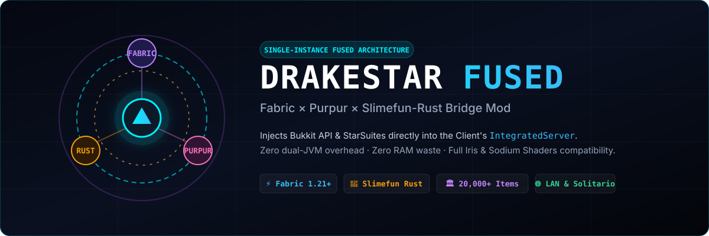

<!-- credits:start -->
> **Credits & license.** Port and maintenance by [JackStar6677-1](https://github.com/JackStar6677-1) and [DrakesCraft Labs](https://github.com/SlimefunNewHorizons). Original authors: original work by [JackStar6677-1](https://github.com/JackStar6677-1). Upstream license: **MIT License** (see [LICENSE](LICENSE)). Details: [docs/UPSTREAM_ATTRIBUTION.md](docs/UPSTREAM_ATTRIBUTION.md) · Policy: [Rights & Attribution](https://github.com/SlimefunNewHorizons/.github/blob/main/RIGHTS_AND_ATTRIBUTION.md). Independent community project, not affiliated with or endorsed by the original authors or the official Slimefun team.
>
> **Créditos y licencia.** Port y mantenimiento por [JackStar6677-1](https://github.com/JackStar6677-1) y [DrakesCraft Labs](https://github.com/SlimefunNewHorizons). Autores originales: obra original de [JackStar6677-1](https://github.com/JackStar6677-1). Licencia original: **MIT License**. Detalle en [docs/UPSTREAM_ATTRIBUTION.md](docs/UPSTREAM_ATTRIBUTION.md).
<!-- credits:end -->

<div align="center">



# ⚡ DrakeStar Fused (`drakestar-fused`)
### *Universal bridge mod (alpha.4) — embedded DrakesPurpur 26.2 + Slimefun host inside Fabric 26.2 (Java 25+)*

[](https://github.com/SlimefunNewHorizons/drakestar-fused/actions/workflows/build-test.yml)
[](LICENSE)
[](https://fabricmc.net/)
[](https://papermc.io/)
[](https://github.com/SlimefunNewHorizons)

**English** · [Español](#-visión-arquitectónica-en-español)

</div>

---

## Estado real / Actual status (alpha.4)

- **Funciona hoy**:
  - Jars universales para **Fabric, NeoForge y Forge** (`drakestar-fused-<loader>-universal-<version>.jar`) compatibles con **Minecraft 1.20 a 26.2**, sin mixins (`release-artifacts/check_jar.py`).
  - **Servidor embebido en la misma JVM (Fabric 26.2, Java 25+, Paso 5)**: cuando el [DrakeStar Launcher](https://github.com/SlimefunNewHorizons/DrakeStar-Launcher) lanza la plantilla «Slimefun en solitario / LAN» (`slimefun-solo`, `fused: true`) con `-Ddrakestar.fused.embedded.jar=<monolito>` y `-Ddrakestar.fused.embedded.server=<dir>`, `DrakeStarFusedClient` arranca el monolito **DrakesPurpur 26.2 (`b141`)** con **Slimefun + las 9 suites (`Drakes-Suites@26.x`) y el motor nativo Rust FFM/JNI** dentro de la misma JVM del cliente mediante un cargador aislado (`Embed` / `SpikeLoader` / `SpikeHooks`), sin levantar un segundo proceso de servidor, redirigiendo rutas a `server/`, aislando Log4j2 y bibliotecas JNI por cargador, e interceptando `System.exit` al parar (evidencia reproducible en [`docs/EMBEDDED_SERVER_SPIKE.md`](docs/EMBEDDED_SERVER_SPIKE.md)).
- **Qué NO hace todavía**: fuera del modo de monolito embebido en 26.2 (Java 25+), el puente `FusedCraftServer` en el `IntegratedServer` vanilla solo prepara `plugins/`, detecta jars y enlaza el puente Rust si existe (no traduce plugins Bukkit sobre mundos singleplayer vanilla 1.20–1.21).
- Las releases `v1.0.0-alpha.1` y `alpha.2` usaban mixins sin remapear y **fallan al arrancar** en el juego real: no usarlas.
- Para publicar: subir `mod_version` en `gradle.properties` y empujar la etiqueta `vX.Y.Z`; el flujo compila, valida los tres jars (`release-artifacts/check_jar.py`) y crea la release.
- Sin descargas remotas ni navegador automatico: `-Ddrakestar.fused.provision=true` activa la descarga de suites; `-Ddrakestar.fused.openIssue=true` abre el enlace de reporte de fallos.

---

> [!IMPORTANT]
> **Todo lo que sigue desde aquí hasta «Networking» describe el puente directo sobre `IntegratedServer` (VISIÓN / DISEÑO OBJETIVO para 1.20–1.21) frente al modo de monolito embebido ya activo en 26.2 (`v1.0.0-alpha.4`).** En `v1.0.0-alpha.4` el modo **monolito DrakesPurpur 26.2 embebido en la misma JVM del cliente Fabric 26.2 (Java 25+)** ya funciona y está verificado paso a paso en [`docs/EMBEDDED_SERVER_SPIKE.md`](docs/EMBEDDED_SERVER_SPIKE.md) (10/10 plugins con Slimefun + 9 suites y motor nativo Rust FFM/JNI activos, sin proceso de servidor externo, conectado a la plantilla `slimefun-solo` del [DrakeStar Launcher](https://github.com/SlimefunNewHorizons/DrakeStar-Launcher)). En cambio, sobre el `IntegratedServer` vanilla (sin monolito 26.2), `FusedCraftServer` solo prepara `plugins/` y no traduce plugins Bukkit. Ver «Estado real» arriba.
>
> *In `v1.0.0-alpha.4`, the embedded DrakesPurpur 26.2 monolith mode inside the Fabric 26.2 client JVM (Java 25+, isolated classloader `Embed` / `SpikeLoader` / `SpikeHooks`, Slimefun + 9 StarSuites + Rust FFM/JNI engine) is implemented and verified in [`docs/EMBEDDED_SERVER_SPIKE.md`](docs/EMBEDDED_SERVER_SPIKE.md). The sections below describe the broader `IntegratedServer` bridge architecture (still a design goal for non-monolith 1.20–1.21 worlds).*

## 🏛️ Executive Summary — design vision (not implemented)

**DrakeStar Fused** is an open-source bridge mod engineered for Minecraft Java Edition. It solves the historical dilemma of running enterprise Bukkit plugins (specifically **Slimefun v11** and the **StarSuites** 20,000+ technical item matrix) alongside modern client-side performance and aesthetic modpacks (such as **Iris Shaders**, **Sodium**, **Distant Horizons**, and **Sodium-Extra**).

Traditionally, playing heavy Bukkit modded environments locally required running **two separate JVM instances**:
1. A dedicated headless server (`paper.jar` / `purpur.jar`) consuming 3 to 6 GB of RAM.
2. A Minecraft Java client instance consuming another 4 to 8 GB of RAM.

This dual-JVM approach doubles CPU overhead, causes severe garbage collection pauses on laptops and mid-tier workstations, and introduces port forwarding headaches for local play.

**DrakeStar Fused fuses the Bukkit runtime directly inside Minecraft's internal `IntegratedServer`**.

---

## 🔮 Key Architectural Pillars — target design (not implemented)

```
+---------------------------------------------------------------------------------+
|                         MINECRAFT CLIENT (SINGLE JVM)                           |
|                                                                                 |
|  +--------------------------------+   +---------------------------------------+  |
|  |     RENDER ENGINE (CLIENT)     |   |          INTEGRATED SERVER            |  |
|  |   Iris / Sodium / Embeddium    |   |                                       |  |
|  |   Modern UI / Blackwall HUD    |   |  +---------------------------------+  |  |
|  +--------------------------------+   |  |     DrakeStar Fused Mixins      |  |  |
|                  |                    |  +---------------------------------+  |  |
|                  | Local Connection   |                  |                    |  |
|                  | (Direct Memory)    |  +---------------------------------+  |  |
|                  v                    |  |   Bukkit API / CraftServer Host |  |  |
|  +--------------------------------+   |  +---------------------------------+  |  |
|  |   Integrated Player Connection |   |                  |                    |  |
|  +--------------------------------+   |  +---------------------------------+  |  |
|                                       |  | StarSuites & Slimefun Plugins   |  |  |
|                                       |  | (drakes-core, drakes-tech, etc) |  |  |
|                                       |  +---------------------------------+  |  |
|                                       |                  | (FFM ABI 1)        |  |
|                                       |  +---------------------------------+  |  |
|                                       |  | libdrakes_hybrid_ffi.so (Rust)  |  |  |
|                                       |  |  - Energy Grids SIMD Ticker     |  |  |
|                                       |  |  - Off-Heap Block Storage       |  |  |
|                                       |  +---------------------------------+  |  |
|                                       +---------------------------------------+  |
+---------------------------------------------------------------------------------+
```

1. **Zero Dual-JVM Overhead**:
   - Single process lifecycle. When you pause, open your world to LAN, or close to title, the internal server and Bukkit lifecycles start and stop seamlessly in the same JVM.
2. **Purpur 26.2 Engine Injection via Fabric Mixins**:
   - Hooks into `net.minecraft.server.integrated.IntegratedServer` during world initialization.
   - Bootstraps a lightweight `CraftServer` instance with Bukkit `PluginManager`, loading `.jar` plugins from `instance/plugins/`.
3. **Rust SIMD Off-Heap Energy & Machine Tickers**:
   - Direct JNI / Java 25 Foreign Function & Memory (FFM) binding to `libdrakes_hybrid_ffi.so`.
   - Massive energy networks (Networks V6, Infinity Expansion, Quantum Storage) calculate off-heap with AVX-512 VNNI instructions without triggering Java GC pauses.
4. **Shader & Client Mod Harmony** *(goal; not verified)*:
   - Intended to coexist with Fabric client mods (Sodium, Iris, REI, minimaps). Only the launcher's performance set has been launched alongside Fused alpha.3.

---

## 🗂️ Project Structure

```
drakestar-fused/
├── assets/
│   └── drakestar-fused-banner.svg     # Official vector visual banner
├── common/                             # Shared engine abstractions & FFM bridges
│   └── src/main/java/com/drakescraft/fused/
│       ├── api/FusedLifecycleListener.java
│       └── rust/SlimefunRustNativeBridge.java
├── fabric/                             # Fabric Loader module (First Priority)
│   ├── build.gradle
│   ├── src/main/java/com/drakescraft/fused/
│   │   ├── DrakeStarFusedClient.java
│   │   ├── DrakeStarFusedMod.java
│   │   ├── mixin/
│   │   │   ├── IntegratedServerMixin.java
│   │   │   └── MinecraftServerMixin.java
│   │   └── bridge/
│   │       ├── FusedCraftServer.java
│   │       └── FusedPluginLoader.java
│   └── src/main/resources/
│       ├── fabric.mod.json
│       └── drakestar-fused.mixins.json
├── neoforge/                           # NeoForge compatibility module
│   └── src/main/java/com/drakescraft/fused/neoforge/DrakeStarFusedNeoForge.java
├── forge/                              # Classic Forge compatibility module
│   └── src/main/java/com/drakescraft/fused/forge/DrakeStarFusedForge.java
├── docs/
│   └── NETWORKING_AND_LAN_GUIDE.md    # Critical Guide on LAN vs Essential Mod conflict
└── README.md
```

---

## ⚠️ Networking & LAN Hosting Guidelines (Essential Mod Conflict)

Please read our dedicated [Networking and LAN Guide](docs/NETWORKING_AND_LAN_GUIDE.md).

> [!CAUTION]
> **DO NOT USE ESSENTIAL MOD WITH DRAKESTAR FUSED.**  
> Mods like **Essential Mod** or **e4mc** hijack the internal packet layer with proprietary UPnP tunnels. With over 20,000 custom Slimefun items and off-heap Rust tickers, Essential Mod drops custom payload packets, corrumpts world tile entities, and causes thread lockups.

**Recommended Multiplayer Approaches:**
* **Option A (Friends):** Use native Minecraft **Open to LAN** or connect via private virtual mesh network (**Tailscale / WireGuard**).
* **Option B (Slimefun today):** use the **DrakeStar Launcher** «Slimefun solo / LAN» instance: it runs the DrakesPurpur server locally and joins it (see the launcher's `docs/LAUNCHER.md`).

---

## 🛠️ Building & Compiling on Nova (Intel i7 Tiger Lake / AVX-512)

Following the sovereign hardware rules of node **Nova**, builds are strictly constrained to preserve KDE Plasma UI smoothness:

```bash
# Recommended build command on Nova (uses max 4 threads to keep 4 threads free)
export MAVEN_OPTS="-Xmx3584m -XX:+UseParallelGC"
export GRADLE_OPTS="-Dorg.gradle.jvmargs=-Xmx3584m -Dorg.gradle.parallel=true -Dorg.gradle.workers.max=4"

# Build Fabric Mod JAR
./gradlew build
```

---

## 🇪🇸 Visión Arquitectónica en Español — diseño objetivo, no estado real

### ¿Por qué existe DrakeStar Fused?
El ecosistema de **Slimefun** enriquecido con **StarSuites** contiene más de 20,000 ítems, máquinas cuánticas, reactores nucleares, bio-ingeniería genética y redes de energía. Hasta la fecha, jugarlo requería montar un servidor Paper/Purpur dedicado y luego abrir un cliente de Minecraft por separado para conectarse a `localhost`.

En laptops y computadores personales, tener dos instancias completas de Java devora entre 8 y 14 GB de memoria RAM y satura la CPU con la recolección de basura (GC).

**En `v1.0.0-alpha.4` (modo monolito embebido 26.2, Java 25+), DrakeStar Fused une los tres mundos en una sola JVM (`docs/EMBEDDED_SERVER_SPIKE.md`):**
1. **Fabric Loader**: Te permite cargar tus mods favoritos de optimización (Sodium, Iris, Lithium, Indium) y shaders cinematográficos.
2. **Purpur / Bukkit**: Ejecuta el monolito **DrakesPurpur 26.2 (`b141`)** con **Slimefun + las 9 suites** dentro de la misma JVM del cliente mediante un cargador aislado (`Embed` / `SpikeLoader` / `SpikeHooks`), sin requerir una segunda ventana ni un proceso de servidor externo (y en mundos vanilla 1.20–1.21 prepara el puente `IntegratedServer`).
3. **Rust Off-Heap SIMD (`Slimefun-Rust`)**: Conecta el cálculo de redes eléctricas y almacenamiento masivo a librerías nativas en Rust (`libslimefun_ffi.so`, `libodysseia_ffi.so`, `libdrakes_hybrid_ffi.so`) compartidas vía FFM y rutas JNI aisladas por cargador.

### Soporte Multi-Loader (`v1.0.0-alpha.4` publica los 3 jars universales 1.20–26.2):
1. 🚀 **Módulo 1 (Fabric Loader):** `drakestar-fused-fabric-universal-1.0.0-alpha.4.jar` — incluye además el host de monolito embebido 26.2 (`Embed` / `SpikeLoader` / `SpikeHooks`) integrado con la plantilla `slimefun-solo` del launcher.
2. 🛠️ **Módulo 2 (NeoForge Loader):** `drakestar-fused-neoforge-universal-1.0.0-alpha.4.jar` — puente `common` sin mixins verificado en la misma JVM que el monolito 26.2 ([evidencia paso 4](docs/evidence/embedded-step4-neoforge-forge-20261121/README.md)).
3. ⚙️ **Módulo 3 (Forge Clásico):** `drakestar-fused-forge-universal-1.0.0-alpha.4.jar` — puente `common` sin mixins verificado en la misma JVM que el monolito 26.2 ([evidencia paso 4](docs/evidence/embedded-step4-neoforge-forge-20261121/README.md)).

---

## 📜 Licencia & Créditos Soberanos

- **Autor & Arquitecto:** JackStar6677 — Arquitecto Jefe de DrakesCraft & Star.
- **Organización Upstream:** [SlimefunNewHorizons](https://github.com/SlimefunNewHorizons)
- **Licencia:** MIT License. Código abierto para la comunidad.
