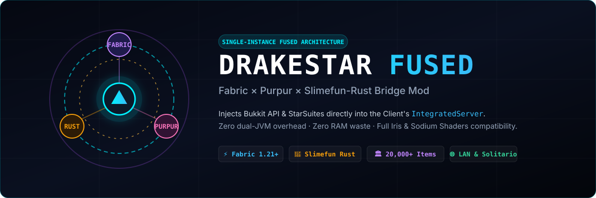

<div align="center">



# ⚡ DrakeStar Fused (`drakestar-fused`)
### *The Next-Generation Fabric × Purpur × Slimefun-Rust Bridge Mod*

[](LICENSE)
[](https://fabricmc.net/)
[](https://papermc.io/)
[](https://github.com/SlimefunNewHorizons)
[](https://github.com/SlimefunNewHorizons)

**English** · [Español](#-visión-arquitectónica-en-español)

</div>

---

## 🏛️ Executive Summary

**DrakeStar Fused** is an open-source bridge mod engineered for Minecraft Java Edition. It solves the historical dilemma of running enterprise Bukkit plugins (specifically **Slimefun v11** and the **StarSuites** 20,000+ technical item matrix) alongside modern client-side performance and aesthetic modpacks (such as **Iris Shaders**, **Sodium**, **Distant Horizons**, and **Sodium-Extra**).

Traditionally, playing heavy Bukkit modded environments locally required running **two separate JVM instances**:
1. A dedicated headless server (`paper.jar` / `purpur.jar`) consuming 3 to 6 GB of RAM.
2. A Minecraft Java client instance consuming another 4 to 8 GB of RAM.

This dual-JVM approach doubles CPU overhead, causes severe garbage collection pauses on laptops and mid-tier workstations, and introduces port forwarding headaches for local play.

**DrakeStar Fused fuses the Bukkit runtime directly inside Minecraft's internal `IntegratedServer`**.

---

## 🔮 Key Architectural Pillars

```
+---------------------------------------------------------------------------------+
|                         MINECRAFT CLIENT (SINGLE JVM)                           |
|                                                                                 |
|  +--------------------------------+   +---------------------------------------+  |
|  |     RENDER ENGINE (CLIENT)     |   |          INTEGRATED SERVER            |  |
|  |   Iris / Sodium / Embeddium    |   |                                       |  |
|  |   Modern UI / Blackwall HUD    |   |  +---------------------------------+  |  |
|  +--------------------------------+   |  |     DrakeStar Fused Mixins      |  |  |
|                  |                    |  +---------------------------------+  |  |
|                  | Local Connection   |                  |                    |  |
|                  | (Direct Memory)    |  +---------------------------------+  |  |
|                  v                    |  |   Bukkit API / CraftServer Host |  |  |
|  +--------------------------------+   |  +---------------------------------+  |  |
|  |   Integrated Player Connection |   |                  |                    |  |
|  +--------------------------------+   |  +---------------------------------+  |  |
|                                       |  | StarSuites & Slimefun Plugins   |  |  |
|                                       |  | (drakes-core, drakes-tech, etc) |  |  |
|                                       |  +---------------------------------+  |  |
|                                       |                  | (FFM ABI 1)        |  |
|                                       |  +---------------------------------+  |  |
|                                       |  | libdrakes_hybrid_ffi.so (Rust)  |  |  |
|                                       |  |  - Energy Grids SIMD Ticker     |  |  |
|                                       |  |  - Off-Heap Block Storage       |  |  |
|                                       |  +---------------------------------+  |  |
|                                       +---------------------------------------+  |
+---------------------------------------------------------------------------------+
```

1. **Zero Dual-JVM Overhead**:
   - Single process lifecycle. When you pause, open your world to LAN, or close to title, the internal server and Bukkit lifecycles start and stop seamlessly in the same JVM.
2. **Purpur 26.2 Engine Injection via Fabric Mixins**:
   - Hooks into `net.minecraft.server.integrated.IntegratedServer` during world initialization.
   - Bootstraps a lightweight `CraftServer` instance with Bukkit `PluginManager`, loading `.jar` plugins from `instance/plugins/`.
3. **Rust SIMD Off-Heap Energy & Machine Tickers**:
   - Direct JNI / Java 25 Foreign Function & Memory (FFM) binding to `libdrakes_hybrid_ffi.so`.
   - Massive energy networks (Networks V6, Infinity Expansion, Quantum Storage) calculate off-heap with AVX-512 VNNI instructions without triggering Java GC pauses.
4. **Shader & Client Mod Harmony**:
   - 100% compatible with Fabric client mods: Sodium, Iris Shaders, Fabric Language Kotlin, Roughly Enough Items (REI), and minimaps.

---

## 🗂️ Project Structure

```
drakestar-fused/
├── assets/
│   └── drakestar-fused-banner.svg     # Official vector visual banner
├── fabric/                             # Fabric Loader module (First Priority)
│   ├── build.gradle
│   ├── src/main/java/com/drakescraft/fused/
│   │   ├── DrakeStarFusedClient.java
│   │   ├── DrakeStarFusedServer.java
│   │   ├── mixin/
│   │   │   ├── IntegratedServerMixin.java
│   │   │   └── MinecraftServerMixin.java
│   │   └── bridge/
│   │       ├── FusedCraftServer.java
│   │       └── FusedPluginLoader.java
│   └── src/main/resources/
│       ├── fabric.mod.json
│       └── drakestar-fused.mixins.json
├── common/                             # Shared engine abstractions & FFM bridges
├── forge/                              # Planned Forge compatibility module
├── neoforge/                           # Planned NeoForge compatibility module
└── README.md
```

---

## 🛠️ Building & Compiling on Nova (Intel i7 Tiger Lake / AVX-512)

Following the sovereign hardware rules of node **Nova**, builds are strictly constrained to preserve KDE Plasma UI smoothness:

```bash
# Recommended build command on Nova (uses max 4 threads to keep 4 threads free)
export MAVEN_OPTS="-Xmx3584m -XX:+UseParallelGC"
export GRADLE_OPTS="-Dorg.gradle.jvmargs=-Xmx3584m -Dorg.gradle.parallel=true -Dorg.gradle.workers.max=4"

# Build Fabric Mod JAR
./gradlew build
```

---

## 🇪🇸 Visión Arquitectónica en Español

### ¿Por qué existe DrakeStar Fused?
El ecosistema de **Slimefun** enriquecido con **StarSuites** contiene más de 20,000 ítems, máquinas cuánticas, reactores nucleares, bio-ingeniería genética y redes de energía. Hasta la fecha, jugarlo requería montar un servidor Paper/Purpur dedicado y luego abrir un cliente de Minecraft por separado para conectarse a `localhost`.

En laptops y computadores personales, tener dos instancias completas de Java devora entre 8 y 14 GB de memoria RAM y satura la CPU con la recolección de basura (GC).

**DrakeStar Fused une los tres mundos:**
1. **Fabric Loader**: Te permite cargar tus mods favoritos de optimización (Sodium, Iris, Lithium, Indium) y shaders cinematográficos.
2. **Purpur / Bukkit**: Inyecta en el servidor interno (`IntegratedServer`) la capacidad de cargar plugins Spigot/Paper/Purpur sin requerir una segunda ventana o servidor externo.
3. **Rust Off-Heap SIMD (`Slimefun-Rust`)**: Conecta el cálculo de redes eléctricas y almacenamiento masivo a librerías nativas en Rust compiladas con AVX-512, liberando a Java de cualquier micro-lag o caída de TPS.

### Roadmap de Soporte Multi-Loader:
1. 🚀 **Módulo 1 (Fabric Loader):** Implementación principal y más liviana.
2. 🛠️ **Módulo 2 (NeoForge Loader):** Para usuarios de modpacks modernos basados en NeoForge.
3. ⚙️ **Módulo 3 (Forge Clásico):** Soporte de retrocompatibilidad para packs tradicionales.

---

## 📜 Licencia & Créditos Soberanos

- **Autor & Arquitecto:** JackStar6677-1 (`pablo.elias.miranda.292003@gmail.com`) — Arquitecto Jefe de DrakesCraft & Star.
- **Organización Upstream:** [SlimefunNewHorizons](https://github.com/SlimefunNewHorizons)
- **Licencia:** MIT License. Código abierto para la comunidad.
